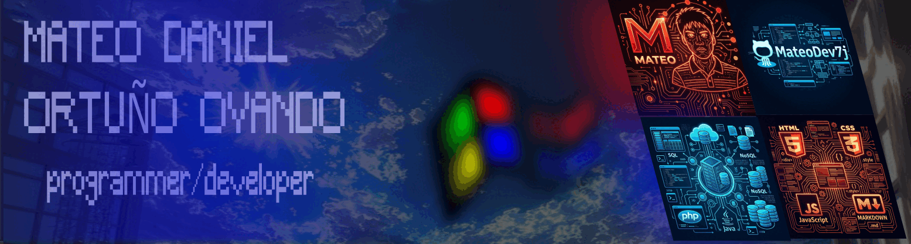

<!-- MATEO.DEV | PROFILE README -->

<div align="center">



<br/>

# Building ideas into software.

**DAW Student · Java · Web Development · Databases**

*Learning by building. Improving through every project.*

<br/>

[](https://github.com/MateoDev7j)
[](https://dev.java/)
[](https://developer.mozilla.org/)

</div>

---

## `01 / ABOUT`

I'm Mateo, a web application development student building my foundations in software engineering.

I enjoy understanding how applications work, solving problems step by step, and turning what I learn into practical projects.

- **Currently studying:** Web Application Development (DAW).
- **Working with:** Java, HTML, SQL and Git.
- **Exploring:** Object-oriented programming, databases and web technologies.
- **My approach:** Write code, understand it, document it, improve it.

---

## `02 / TECHNOLOGY STACK`

| Area | Technologies |
|---|---|
| Programming | Java, Php, C++ |
| Web | HTML, CSS, Javascript |
| Databases | SQL, relational database design |
| Tools | Git, GitHub, VS Code, Phpstorm, Netbeans |
| Currently learning | JavaScript and backend development |

---

## `03 / SELECTED PROJECTS`

### `[01]` Java Projects
Programming exercises and practical projects covering Java fundamentals and object-oriented programming.

**Focus:** Problem solving · Control flow · Classes and objects

[Explore repository →](https://github.com/MateoDev7j/java-projects)

### `[02]` Database Engineering
My learning journey in database design, SQL and data organization.

**Focus:** Data modeling · Queries · Database fundamentals

[Explore repository →](https://github.com/MateoDev7j/Base_de_Datos)

### `[03]` Systems & Development Environments
Technical notes and practical work exploring computer systems and development tools.

**Focus:** Hardware · Software · Development environments

[Explore repository →](https://github.com/MateoDev7j/Sistemas_informaticos)

---

## `04 / CURRENT MISSION`

```text
[ IN PROGRESS ]  Strengthen Java fundamentals
[ IN PROGRESS ]  Build better database projects
[ NEXT          ]  Develop interactive web applications
[ LONG TERM     ]  Become a well-rounded developer
```

---

## `05 / GITHUB ACTIVITY`

<div align="center">


</div>

---

<div align="center">

**MATEO.DEV** · Built with curiosity and code.

<sub>Every project is another step forward.</sub>

</div>
